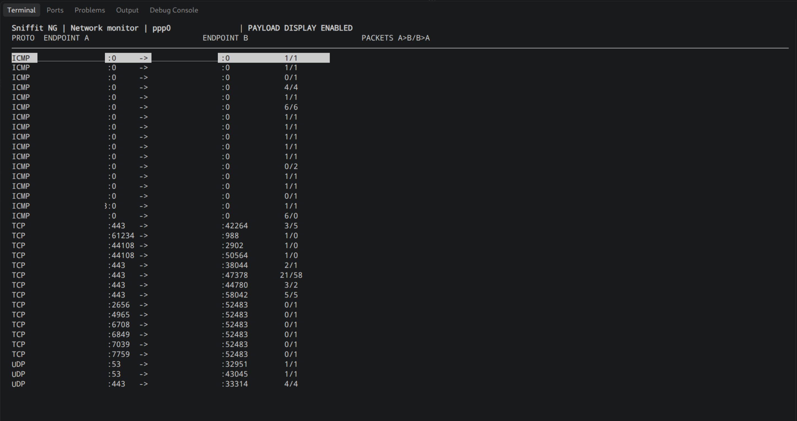
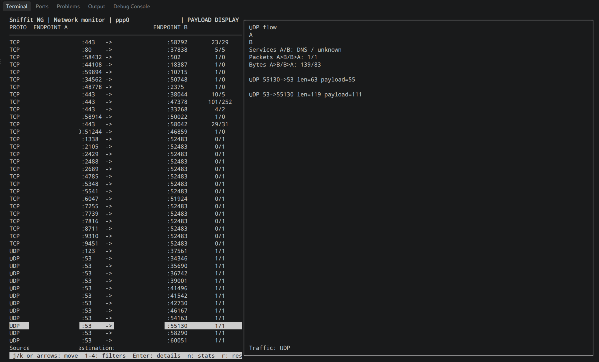

# Sniffit NG

## Executive Summary

Sniffit NG is a lightweight terminal network monitor and packet analyzer. Watch a network interface live or open a saved capture. Sniffit groups packets into connections, shows traffic in both directions, and displays selected details about supported protocols. This can help you see whether a connection attempt received a reply and where an exchange may have stopped. It cannot prove that an application worked or determine whether traffic is malicious.

Use Sniffit NG only on systems and networks you own or have permission to monitor. Normal display shows summaries, not packet contents. Packet recording and payload viewing are separate, opt-in features with privacy checks.

## Screenshots





### What it currently supports

- Live capture and saved pcap files on Ethernet and Linux cooked v1 (SLL) links.
- IPv4 connections, packet counts, traffic rates, address and port filters, and packet error counts.
- Short summaries for TCP, UDP, HTTP/1.x, TLS records, DNS, DHCPv4/BOOTP, NTP, SNMP, Syslog, RADIUS, TACACS+, QUIC, RTP/RTCP, ICMP, IGMP, and VRRP.
- A terminal view with connection details and basic source/destination filters.

These are summaries, not complete protocol decoders. IPv6 is not yet supported. TCP is not reassembled across packets, so a message split between packets may be missed. HTTPS contents are not decrypted. Sniffit limits how many connections and details it keeps in memory. Multi-day use still needs longer testing.

Select a connection and press Enter to see details. Use arrow keys or `j`/`k` to move between connections. Keys `1` through `4` set source/destination address and port filters. These filters change what is displayed, not what is captured or counted. See the [development plan](PLAN.md) for planned filters and display improvements.

This repository currently has no license. Public visibility does not itself grant permission to reuse, modify, or redistribute the code.

## Build and test

Requirements: C17 compiler, CMake 3.16 or newer, pkg-config, and libpcap, ncursesw, and libcurl development files.

```sh
cmake -S . -B build -DSNIFFIT_NG_ENABLE_SANITIZERS=ON
cmake --build build
ctest --test-dir build --output-on-failure
./build/sniffit-ng --help
./build/sniffit-ng --read-pcap capture.pcap
sudo ./build/sniffit-ng --interface lo
```

To record packets from an offline replay or live interface to a new pcap file, use `--write-pcap FILE`. Since a pcap retains complete packet contents, recording requires the interactive privacy/authorization acknowledgment. The file is created exclusively with owner-only permissions; existing files and symlinks are rejected. Live output is opened only after capture privileges are dropped.

```sh
./build/sniffit-ng --read-pcap input.pcap --write-pcap output.pcap
sudo ./build/sniffit-ng --interface lo --write-pcap loopback.pcap
```

### Packet Parser Fuzzing

With Clang/libFuzzer installed, build the optional Ethernet/SLL parser fuzzer and run a short smoke pass:

```sh
cmake -S . -B build/fuzz -DCMAKE_C_COMPILER=clang \
	-DSNIFFIT_NG_BUILD_PACKET_FUZZER=ON -DBUILD_TESTING=OFF
cmake --build build/fuzz --target fuzz_packet
./build/fuzz/fuzz_packet -runs=5000 -max_len=1024
```

The harness tries raw inputs and structured IPv4 frames over Ethernet/SLL, including TCP, UDP, ICMP, IGMP, and VRRP. Use a persistent corpus and longer runs for sustained fuzzing.

Live capture uses non-promiscuous mode by default. Request promiscuous capture explicitly with `--promiscuous`. On Linux, capture can use a protected, root-owned installation with `CAP_NET_RAW` instead of running the whole program as root:

```sh
sudo setcap cap_net_raw+p /usr/local/bin/sniffit-ng
getcap /usr/local/bin/sniffit-ng
/usr/local/bin/sniffit-ng --interface lo
```

Sniffit uses that capability only while opening the capture source, then drops it before processing packets or entering the terminal view. Never set capabilities on a binary that ordinary users can modify. Promiscuous capture may need additional privileges. Only Ethernet and Linux cooked v1 (SLL) are supported currently. In live mode, the title bar shows the selected interface and its IPv4 address when available.

### RPM and DEB Packages

On Linux, CPack generates RPM and DEB packages from the install rules. Build a non-sanitized release tree with tests disabled, then invoke the `package` target:

```sh
cmake -S . -B build/release -DCMAKE_BUILD_TYPE=Release -DBUILD_TESTING=OFF
cmake --build build/release --target package
```

Packages are written to `build/release/packages/`. Runtime dependencies are declared/discovered by CPack; generated packages do not set file capabilities. Configure capture privilege separately after installation, and never assign `CAP_NET_RAW` to a developer-writable executable. This source tree currently has no license, so package creation does not grant redistribution rights; resolve licensing before publishing packages for general use.

## Privacy and Ethical Use

Only monitor systems and networks you own or are explicitly authorized to inspect. Respect consent and applicable law. Collect only what you need, protect any saved data, set a retention period, and delete it when it is no longer needed.

External address lookup is off by default. To opt in, add `resolve_external_addr = true` to the config file. If the selected live interface has an RFC 1918 IPv4 address, Sniffit makes one HTTPS request to `https://ifconfig.io/ip` at startup and shows the returned address in the title bar. The service can observe your public network address. No request is made for offline replay, public interface addresses, or when the setting is absent or false. If the lookup fails, monitoring continues with local interface information only.

Normal flow summaries and protocol details do not display packet contents. Full-packet recording and payload viewing are more sensitive and remain separate, opt-in features.

A pcap file can contain complete packet contents. `--write-pcap FILE` therefore requires an interactive privacy and authorization acknowledgment. Sniffit creates a new owner-only file and refuses to overwrite an existing file. Live recording starts only after capture privileges have been dropped.

Payload logging is disabled by default. For an offline replay, `--payload-logging` writes validated payload bytes as hexadecimal. Use `--payload-log PATH` to choose a new output file. Sniffit asks for an interactive acknowledgment, creates the file exclusively with owner-only permissions, and fails closed if no terminal is available. Protect the file and delete it according to your retention policy.

### Optional ICMP Echo Samples

Connection summaries and protocol details work without payload inspection. `--inspect-payloads` enables sanitized ICMP Echo samples in the details view. Samples stay in memory: at most 16 records per connection and 64 payload bytes per record. This feature does not write payload data to disk. It is disabled by default and requires this active acknowledgment comment in the config file:

```ini
inspect_payloads = true
## User has acknowledged to behave ethically and inspect only authorized traffic.
```

The config is read from `$XDG_CONFIG_HOME/sniffit-ng/config` or `~/.config/sniffit-ng/config`. Use `--config FILE` to select another file. The `--inspect-payloads` option also requires the acknowledgment in the loaded config. Missing acknowledgment fails closed. The example config keeps inspection disabled and the acknowledgment commented out. This acknowledgment applies only to in-memory ICMP Echo samples; payload logging and pcap recording each require their own interactive acknowledgment.

## Building

Install a C17 compiler, CMake 3.16 or newer, pkg-config, and libpcap, ncursesw, and libcurl development files. From the project root, configure and build a release executable:

```sh
cmake -S . -B build -DCMAKE_BUILD_TYPE=Release
cmake --build build --parallel
```

To run the tests after building:

```sh
ctest --test-dir build --output-on-failure
```
